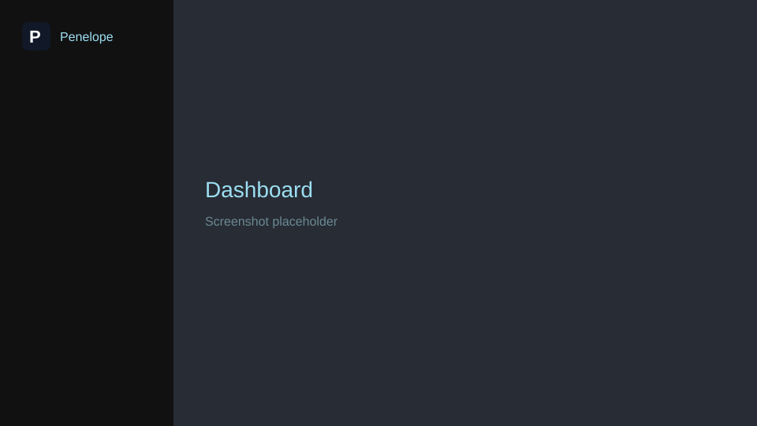
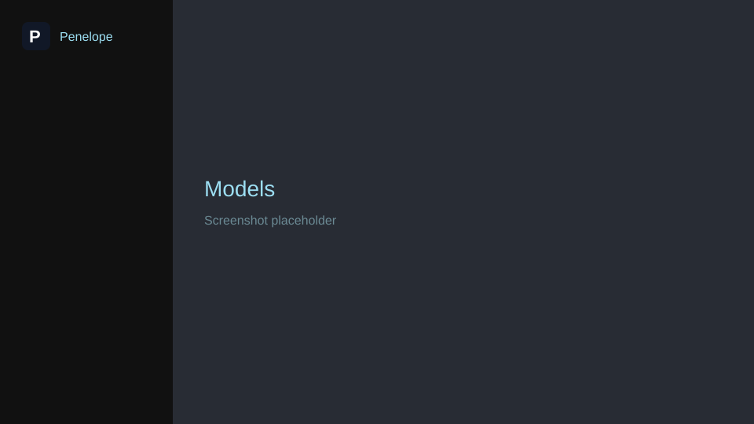
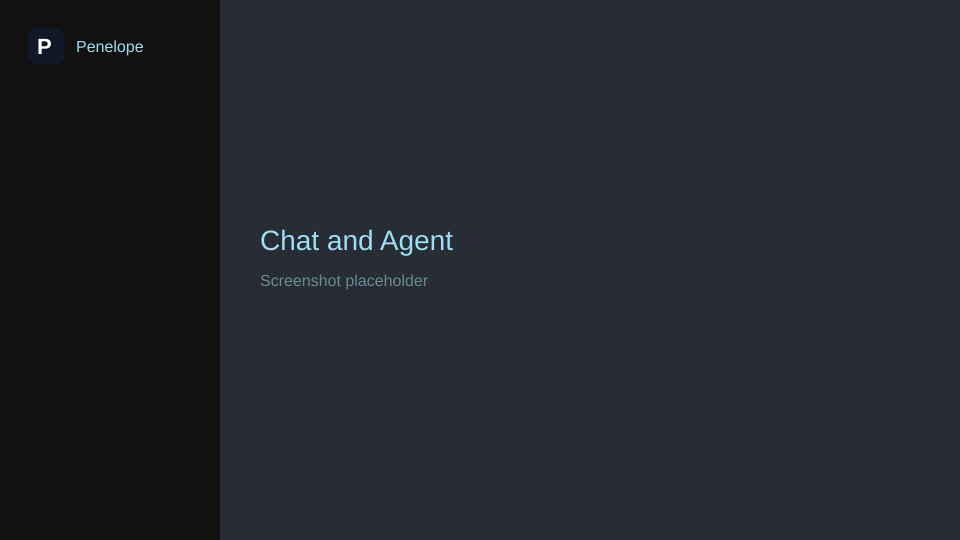
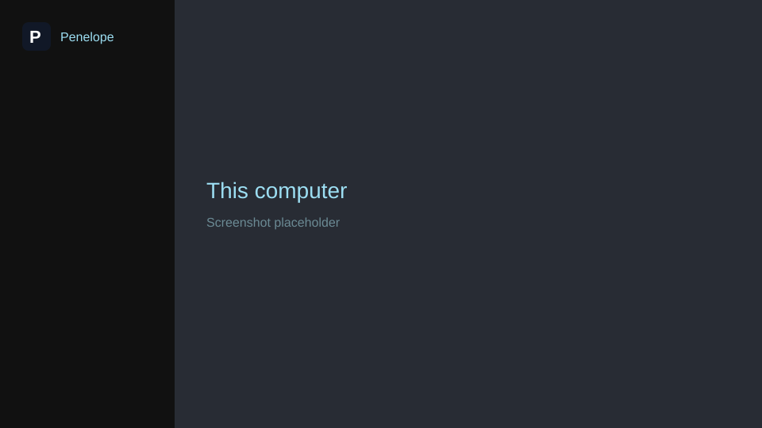

# Penelope

[](LICENSE)
[](#system-requirements)
[](https://dotnet.microsoft.com/)

Penelope makes local AI simple.

Built for users who do not want to use the command line, Penelope provides a clean browser-based dashboard for installing, managing, and running local AI tools. Installing Ollama, downloading models, updating software, and starting or stopping services are all available through simple controls.

By default, the dashboard is only accessible from the local computer and binds to 127.0.0.1. Users may choose to expose the Ollama API to other devices on the local network, while the Penelope management interface remains private and local-only.

## Contents

- [Project introduction](#project-introduction)
- [Features](#features)
- [Screenshots](#screenshots)
- [Installation](#installation)
- [Usage](#usage)
- [Architecture](#architecture)
- [Project goals](#project-goals)
- [Planned integrations](#planned-integrations)
- [Development](#development)
- [Contributing](#contributing)
- [License](#license)
- [Credits and acknowledgements](#credits-and-acknowledgements)

## Project introduction

Local AI is often managed through a terminal. Users must install runtimes, configure servers, remember model names, manage ports, and ensure GPU drivers are working correctly. Penelope exists to bring all of those tasks together into a single, beginner-friendly interface.

Penelope is a management tool for local AI software and services. It helps users install, configure, update, and monitor tools such as Ollama and local AI models through a simple web interface. It can start and stop services, manage models, and provide visibility into CPU, memory, and GPU usage. The goal is simple: make local AI accessible without requiring command-line knowledge.

Penelope is designed to remain tool-agnostic. While Ollama is the first and primary focus, the long-term vision is to support a growing ecosystem of local AI tools. Future versions may help users install, configure, and manage additional applications from a single dashboard.

One of the first planned integrations after Ollama is Odysseus, a separate project that provides a powerful AI workspace for chat, agents, research, and workflows. Penelope is not affiliated with Odysseus and is not intended to replace it. Instead, Penelope aims to make installing and maintaining tools like Odysseus easier for end users.

To support troubleshooting and quick verification, Penelope includes a lightweight Chat page that allows users to confirm that a model is responding correctly. It is intended as a testing and diagnostics tool rather than a full AI workspace.

The name comes from The Odyssey. In Greek mythology, Penelope maintained the household while Odysseus travelled the world on a long and difficult journey. That relationship inspired the name of this project. Just as Penelope prepared and maintained the home, Penelope helps prepare and maintain the local AI environment that other tools depend on.

Any AI tool can be part of the journey. Penelope helps prepare the ship.

## Features

### Current features

These are in the source today.

- A per-user installer, `PenelopeSetup.exe`, with Start menu and desktop shortcuts. It does not ask for an administrator by itself.
- A browser dashboard, a tray icon that reopens it, and a first-visit flow: welcome, Ollama, then an optional starter model.
- Install, start, stop, and update Ollama from the page, with progress, a live log, and a failure card whose fixes are buttons.
- A small model catalog, plus any `name:tag`. Download, load into memory, unload, and remove.
- CPU, memory, graphics, and free space on the models drive. NVIDIA readings come from `nvidia-smi`. AMD and Intel utilization comes from the Windows GPU Engine counter.
- A network switch for Ollama only. The Penelope page stays on `127.0.0.1`. Turning Ollama onto the LAN asks Windows for one private firewall rule.
- Chat and Agent on one page. Chat streams a reply. Agent can search the public web, and no other tool is shipped yet. The transcript stays in the browser tab.
- Plugins. A folder beside the program appears in Tools after restart. The host is not compiled against that folder.
- Optional start when Windows signs in. The switch is off until a person turns it on.

### Planned features

Direction is in [`docs/ROADMAP.md`](docs/ROADMAP.md); task-level progress is in [`docs/IMPLEMENTATION_STATUS.md`](docs/IMPLEMENTATION_STATUS.md).

- A Docker provider plugin.
- An Odysseus plugin for the full chat product.
- A FlashML FreeToken plugin.
- More Agent tools, registered the same way web search is registered today. Files, diagnostics, and tool actions are not in this version.
- A watched Ollama install failure and a watched Ollama update on a clean Windows account. The page and the jobs exist. Those two live checks are still open.
- Penelope updating itself. That stays deferred. Tools already installed are updated from the page, and Penelope does not upgrade them in the background.

### Roadmap highlights

| Phase | What it covers | State |
| --- | --- | --- |
| 0 | Browser session, plugin host, jobs, and the sample tool | Done |
| 1 | See and control Ollama | Done |
| 2 | List, download, load, unload, and remove models | Done |
| 3 | This computer, GPU readings, and the network switch | Partial. The live firewall round trip has not been watched on this PC. |
| 4 | Ollama install and update, first visit, and Penelope's own setup | Partial. The setup builds. A forced install failure and a watched update are still open. |
| Model check | Chat, and Agent with web search | Done |
| 5 | Odysseus | Not started |
| 6 | FlashML FreeToken | Not started |

## Screenshots

The pictures below are placeholders. Replace the files in [`docs/screenshots`](docs/screenshots) when real captures are ready.

<p>
  
  
</p>
<p>
  
  
</p>

| File | Page to capture |
| --- | --- |
| `docs/screenshots/dashboard.svg` | Home, with meters and the primary action |
| `docs/screenshots/models.svg` | Add a model, with a catalog card |
| `docs/screenshots/chat.svg` | Chat, with the mode switch and the active model |
| `docs/screenshots/network.svg` | This computer, with CPU, memory, and GPU |

## Installation

Download `PenelopeSetup.exe` from the project's releases when a release is published. A build from source writes the same file to `artifacts/PenelopeSetup.exe`. That folder is not committed.

1. Double-click `PenelopeSetup.exe`.
2. Leave the desktop shortcut selected if you want one. A Start menu shortcut is always created.
3. Finish the setup. Penelope opens the dashboard.
4. On the first visit, choose whether Penelope starts when you sign in, install Ollama or keep the copy already on the computer, and optionally download the starter model.

The setup installs for the current user under `%LOCALAPPDATA%\Programs\Penelope`. Settings and logs stay in `%LOCALAPPDATA%\Penelope`. Uninstall removes the program and the shortcuts. It leaves those settings, and it leaves Ollama.

Open Penelope from its shortcut or from the tray icon. The address in the browser is a one-time link from that shortcut. Opening `http://127.0.0.1:47321/` on its own shows a locked page on purpose.

### System requirements

- 64-bit Windows on x64.
- A normal user account. Windows may still ask for an administrator when Ollama's installer needs one, or when the firewall rule for Ollama's LAN switch is created.
- Enough free disk space for the models you download. The page checks the models drive before a catalog download.
- A GPU is optional. Models can run on system memory. NVIDIA utilization is read exactly when `nvidia-smi` is available. AMD and Intel cards use the Windows GPU Engine counter.

### Supported Windows versions

Windows 10, version 22H2, and Windows 11. Both are 64-bit. Windows on ARM is not a target of this version.

## Usage

### Basic workflow

1. Open Penelope from the shortcut or the tray icon.
2. Read the status line in the header. Start or Stop there controls Ollama, the first running tool.
3. Use Home for the next useful action: install Ollama, update it, start it, or add a model.
4. Leave Penelope from **Quit** in the sidebar. Ollama keeps running.

The tray icon opens the dashboard or quits Penelope. The dot on that icon, and the dot on a tool card, report status. Green means a service is running, yellow means work is in progress, and red means it is stopped. The logo everywhere else is the plain P tile.

### Managing Ollama

Ollama is a tool inside Penelope, on its own pages.

- **Install** downloads the official Windows installer, checks the published checksum, and runs the per-user setup. An existing Ollama is left in place.
- **Start** and **Stop** control the server. Start does nothing extra if Ollama is already running.
- **Update** appears when a newer official release exists. Penelope asks before it replaces the installed copy.
- **Network** can move Ollama between this computer only and the local network. The Penelope dashboard does not move with it.

A long action shows a progress bar and a log. If it fails, the page explains what happened and offers buttons such as Try again. It does not ask you to type a command.

### Installing models

1. Start Ollama.
2. Open **Add a model**.
3. Choose a catalog card, or enter another `name:tag`.
4. Download. One download runs at a time. Closing Penelope stops it. The page says so before the download starts.
5. **Start** on a model loads it into memory. **Stop** unloads it and frees that memory. Stop does not delete the files. **Remove** deletes the model from disk.

Catalog cards warn when the computer's memory or video memory is below the size that model prefers.

### Testing models using Chat and Agent mode

Open **Chat**.

- The header shows the mode, the provider, and the selected model.
- **Chat** sends the conversation to that model and streams the reply. It does not call tools.
- **Agent** can call web search, then answer from what it found. The page says "Searching the web…" while that happens. A model that cannot use tools is asked to switch back to Chat.
- The transcript remains in the browser tab. Refresh keeps it. Closing the tab clears it. Penelope does not store the conversation on disk.

Agent mode is a check that the model can use a tool. It is not a general assistant, and it cannot change files on the computer.

## Architecture

Penelope is a small host plus plugins.

```text
Browser dashboard  →  Penelope host (127.0.0.1)
                         ├─ session, tray, jobs, readings
                         └─ plugins/
                              └─ ollama/    server, models, network, its own pages
```

The host serves the page, keeps the session on this computer, runs long jobs, reads the machine, and scans `plugins/` at startup. Each plugin folder has a `manifest.json`, a .NET assembly, and an optional page bundle. The host project does not reference the Ollama project. A new folder appears in Tools after the host is restarted.

Ollama's own pages travel inside the plugin. The shell mounts them. Chat and Agent live in the shell. Chat talks to the first plugin that offers a model. Agent tools register through `IAgentToolSource`. Web search is the first of those tools. A later plugin can add tools. It cannot replace `web_search`.

The design rule is that a tool owns its process, its installer, and its version. The shell owns the session, the job log, and the page around that tool.

Contributors and coding agents should start with [`docs/README.md`](docs/README.md): it lists the reading order, which document owns each topic, and the rules that must not break. Layers and boundaries are in [`docs/ARCHITECTURE.md`](docs/ARCHITECTURE.md), and the reasons behind them are in [`docs/ADR/`](docs/ADR/README.md).

## Project goals

- **Simplicity.** One next action on Home. Three steps on the first visit. Status, progress, and errors are sentences.
- **Local-first.** Models and the dashboard stay on this computer. Penelope has no account and sends no telemetry. Agent web search is the one call to the public web, and only when Agent mode is used.
- **Beginners.** Catalog cards name a model in plain language. The tag is secondary. Failure cards offer a button.
- **No command line.** The page never tells a person to open a terminal or to type a command. Developers may build from the SDK. That path is not part of the product.

## Planned integrations

### Odysseus

Odysseus stays the full chat product. The planned integration is a plugin Penelope discovers, with its own pages, in the same way Ollama is discovered today. Penelope's Chat page does not become that product.

### FlashML FreeToken

FreeToken is the same kind of future plugin: its own folder, its own manifest, and no change to the Penelope host. It has not been started.

### Future plugin architecture

The plugin contract is already the way new tools are added.

- A folder under `plugins/` with `manifest.json`.
- A .NET assembly built against host API 1.0, declared in the manifest as `"hostApi": "1.0"`. Compatibility rules are in [`docs/PLUGIN_SYSTEM.md`](docs/PLUGIN_SYSTEM.md#hostapi-versioning).
- An optional `ui/index.js` that exports `mount`. Without it, Penelope shows the generic tool page: status, version, Install, Update, Start, and Stop.
- Optional model and Agent-tool interfaces. A plugin can ignore both.

One plugin that fails to load does not block the others.

## Development

### Technology stack

| Part | Choice |
| --- | --- |
| Host | .NET 10, ASP.NET Core, Windows Forms for the tray |
| Interface | React 19, TypeScript, Vite |
| Plugins | .NET class libraries loaded at startup |
| Installer | Inno Setup 6, per user |
| Tests | xUnit |

`global.json` asks for the .NET SDK `10.0.401` or a later 10.0 feature band.

### Build from source

Install the .NET 10 SDK and Node.js, with npm on `PATH`. Inno Setup 6 is needed only when you want `PenelopeSetup.exe`.

```powershell
dotnet test Penelope.sln
```

The web app is built into `src/Penelope.Host/wwwroot` by Vite. To build the installer, which also builds the web app and a self-contained host:

```powershell
powershell -NoProfile -ExecutionPolicy Bypass -File scripts\publish.ps1
```

The setup file is `artifacts\PenelopeSetup.exe`.

Run the host during development with:

```powershell
dotnet run --project src\Penelope.Host
```

The console prints a one-time dashboard link. Use that link. A second launch signals the instance that is already running.

### Project structure

```text
Penelope/
  branding/                 Logo source, branding/penelope.svg
  docs/                     Specification, architecture, ADRs (start at docs/README.md)
  installer/penelope.iss    Per-user setup
  scripts/publish.ps1       Web build, self-contained host, installer
  src/
    Penelope.Abstractions/  Plugin contracts. Host API 1.0.
    Penelope.Infrastructure/ Download manager, event bus, diagnostic log
    Penelope.Host/          Dashboard, session, tray, jobs, readings
    Penelope.Modules.Ollama/ Ollama plugin. The host does not reference it.
    Penelope.Plugins.Sample/ Throwaway plugin used by tests
    Penelope.Host.Tests/
  plugins/                  Runtime copies the host scans
  web/                      React shell and the Ollama page bundle
  LICENSE                   AGPL-3.0-or-later
  COPYRIGHT                 Notice to place on Penelope source files
  THIRD-PARTY-NOTICES       MIT, OFL, and Apache attributions
```

## Contributing

Contributions are welcome under the [GNU Affero General Public License v3.0 or later](LICENSE).

A few product rules are part of the review:

- A person using Penelope never has to open a terminal. Errors offer a button or a link.
- The dashboard stays on `127.0.0.1`.
- A new tool arrives as a plugin. It does not require a change to the host project.
- Chat remains a model check. The full chat product is Odysseus.

Open an issue or a pull request against this repository. There is no separate contributor agreement.

## License

Penelope is free software under the **GNU Affero General Public License v3.0 or later**. The full text is in [LICENSE](LICENSE). You can redistribute it and change it. If you offer a modified version so that users interact with it over a network, the license requires you to offer them the corresponding source.

```text
Copyright (C) 2026 Penelope contributors

This program is free software: you can redistribute it and/or modify
it under the terms of the GNU Affero General Public License as published
by the Free Software Foundation, either version 3 of the License, or
(at your option) any later version.
```

The block you can paste onto a new Penelope source file is in [COPYRIGHT](COPYRIGHT).

Other licenses stay on their own work. [THIRD-PARTY-NOTICES](THIRD-PARTY-NOTICES) lists them. In short:

| Component | License | Role |
| --- | --- | --- |
| .NET and ASP.NET Core | MIT | Host runtime, included in the self-contained build |
| React, React DOM, React Router | MIT | Dashboard |
| Fira Code | SIL Open Font License 1.1 | Interface font. The text is `web/src/design/fonts/OFL.txt` |
| xUnit and the .NET test SDK | Apache-2.0 | Tests only |
| Ollama | Its own license | Downloaded separately. Not part of this repository |
| Inno Setup | Inno Setup License | Builds `PenelopeSetup.exe`. Not linked into the host |

The setup script installs `LICENSE`, `COPYRIGHT`, `THIRD-PARTY-NOTICES`, and `FiraCode-OFL.txt` next to `Penelope.Host.exe`.

## Credits and acknowledgements

- **Odysseus**, for the visual language of the dashboard and for the chat product Penelope is designed to host later.
- **Ollama**, the local model server Penelope installs and runs.
- **The Fira Code Project Authors**, for Fira Code, used under the SIL Open Font License.
- **The .NET Foundation**, **Meta**, and the **React Router** maintainers, for the MIT-licensed runtime and interface libraries.
- **jrsoftware**, for Inno Setup, which builds the per-user installer.
